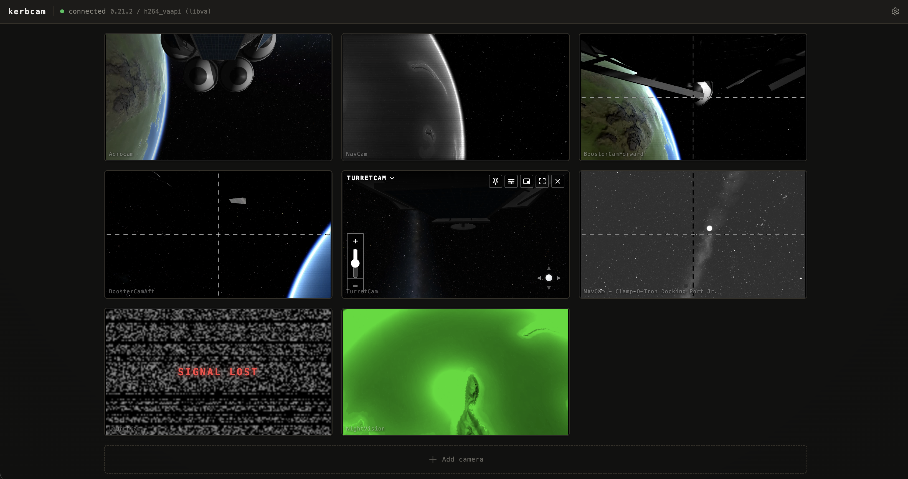
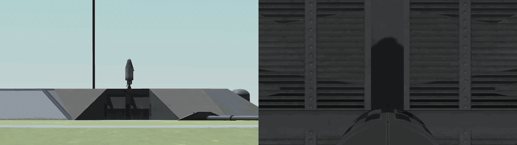

# kerbcast

A from-scratch, high-performance oriented successor to OCISLY for streaming Kerbal Space Program camera feeds to a browser. Hardware-accelerated H.264 over WebRTC, with full Hullcam VDS camera-type fidelity. Designed with Linux in mind, with support for Windows and MacOS.

  

## Features

- Camera sources
  - Streams HullcamVDS camera sources to a browser via the bundled kerbcast web UI or through [@ksp-gonogo/kerbcast](https://www.npmjs.com/package/@ksp-gonogo/kerbcast), a TypeScript SDK
  - Streams each crew member's face as a live camera, seated in the cabin and out on EVA, shown together in a dedicated crew bar
  - Can point a pannable, zoomable camera at the active vessel or its target and have it follow automatically, aiming and zooming to keep it framed
  - Command Cameras: Kerbcast's own API for pointing and tracking custom cameras (see below)
- Supports performance tweak options to keep fps reasonable through degrading resolution, framerate, and shedding render layers. By default, performance should feel vastly improved over the original OCISLY mod
- Introduces optional shaders for wind and re-entry FX
- Supports popular visual mods so their effects show on the camera feeds: Scatterer, EVE, TUFX, Deferred, Firefly, and Parallax
- HullcamVDS implementation enhancements:
  - Honours each camera's `cameraMode` so B&W / CRT / night-vision variants look like they do in the in-game Hullcam GUI
  - Introduces planned but never fully implemented panning options for turret cam and launch cam
  - Supports a data channel for sending control data from clients (eg pan/zoom)
  - Fixes and patches long term issues on Linux

## Command cameras - New in 1.12

  

Command cameras aren't parts on a craft. They stand beside a launch site, at a ground station or anywhere on a body's surface, or ride along with a craft, and stream like any other feed.

- **Launchpad camera**: currently the only command camera supported by the web UI, placed beside the launch pad. It follows the active craft from the pad, panning and zooming to keep it framed through liftoff and the climb
- Point one at a craft, a spot on the ground or a direction in the sky, and it turns smoothly onto the new aim
- Create and aim them from the browser through the TypeScript SDK (`createCommandCamera`, `setCommandAim`)
- Other mods can drive command cameras from their own game logic through `Kerbcast.API`, published on NuGet

### Lenses

Command cameras see like telescopes. Far planets and craft blur by a fixed amount set by the camera's lens, measured in arcseconds (smaller is sharper), and a camera looking up through air also blurs with the air, more so near the horizon. Stars stay sharp. This is on by default; turn off `DeepSpaceOptics` in `settings.cfg` for sharp views.

A camera stops zooming once the blur covers about two pixels, so a better lens also zooms further.

On the ground, the lens follows your Tracking Station level in career (with the tracking rules on, in the difficulty settings). Science and sandbox saves get the level 3 lens. The camera beside the launch pad always has the level 1 lens.

| Tracking Station | Lens | Zooms to about |
|---|---|---|
| Level 1 | 15" | 1.2° |
| Level 2 | 4" | 0.32° |
| Level 3 | 1" | 0.08° (a little wider through the air) |

In space, a camera riding a craft outside any atmosphere gets a space lens, which improves as you research these nodes in career and science saves. Sandbox has the best one. A craft camera always uses the sharper of its space lens and the Tracking Station lens. Ground stations, launch sites, spots on the surface and craft still inside an atmosphere keep the Tracking Station lens.

| Research | Space lens | Zooms to about |
|---|---|---|
| Scanning Tech | 0.5" | 0.04° |
| Advanced Science Tech | 0.2" | 0.016° |
| Experimental Science | 0.05" | 0.004° |

In a career or science save, the flask button at the top of Kerbcast's page shows your current lenses and which space lens steps you have researched. Modded tech trees can point each step at their own node in `settings.cfg`.

## Install

Easiest is **CKAN**. Otherwise grab the latest `kerbcast-*.zip` from the [releases page](https://github.com/ksp-gonogo/kerbcast/releases) (or the [SpaceDock listing](https://spacedock.info/mod/4366/Kerbcast)) and follow the install steps in that release's notes. For a manual install, ensure you also install [Hullcam VDS Continued](https://github.com/linuxgurugamer/HullcamVDSContinued) and [Harmony 2](https://github.com/KSPModdingLibs/HarmonyKSP).

For the longer version with multi-device setup, configuration, info on what's in the bundle, see [docs/INSTALL.md](docs/INSTALL.md). If something doesn't work, [docs/TROUBLESHOOTING.md](docs/TROUBLESHOOTING.md) walks the common failures.

## kOS addon (optional)

**KerbcastKos** lets a [kOS](https://github.com/KSP-KOS/KOS) script running on a vessel enumerate that vessel's kerbcast cameras and control them from kerboscript: set field of view, pan steerable mounts, target-track a moving point (`SET cam:AIM TO { RETURN TARGET:POSITION. }.`), and auto-track the active vessel or its target on a pannable, zoomable camera (`SET cam:TRACK TO "target".`). Auto-track is shared with the browser: a mode set from kerboscript shows up in every viewer, and a viewer-set mode reads back in kerboscript. It ships as a separate optional download (`KerbcastKos-*.zip` on the [releases page](https://github.com/ksp-gonogo/kerbcast/releases)) and needs both kerbcast and kOS installed.

Full API and examples: [GameData/KerbcastKos/README.md](GameData/KerbcastKos/README.md).

## Companion project

[gonogo](https://github.com/ksp-gonogo/gonogo) - a mission-control browser SPA that consumes kerbcast feeds (and a few other things).

## Differences to OCISLY

OCISLY uses `ReadPixels` + `EncodeToJPG` on the game's main thread and ships JPEG over unary gRPC at 30 Hz. That works, but it costs real frame budget, particularly on lower powered devices, and doesn't support the visual character that Hullcam VDS encodes per part. Kerbcast aims to fix both while prioritising high performance through hardware encoding and modern Unity API use.

## Technical Detail

- Captures KSP Hullcam VDS camera feeds inside the game via `AsyncGPUReadback`, with zero stall on the game's main thread
- Encodes them in an out-of-process 'sidecar': software H.264 (OpenH264) as the fallback, with hardware H.264 on Linux / Steam Deck (libva), and NVENC (Windows). VideoToolbox (macOS) is stubbed pending implementation
- Streams them out as WebRTC media tracks, with adaptive bitrate, congestion control, and packet loss recovery for free
- Renders cameras only when a peer is subscribed, so no idle CPU work and no in-game UI required

## Performance

This mod was built initally for getting best performance out of Steam Deck, and it does a good job of it. Regardless of the number of camera renders streaming, Kerbcast can adjust quality and framerate to ensure KSP FPS stays within the ideal range for in-game physics. It also uses a time budget to ensure it doesn't balloon render time. Each stream is SD by default, but can be increased. Render quality will always be able to reduce to ensure streaming continues.

## Toolchain

- Plugin: C# / .NET Framework 4.8, against KSP's Unity 2019.4 LTS assemblies
- Sidecar: Rust (stable), out-of-process H.264 encoder and WebRTC signalling
- Protocol: Rust types in `sidecar/src/protocol/`, TypeScript SDK at `client-sdk/typescript/`

### Dev builds

`scripts/dev-build.sh` builds a test bundle of the current pushed branch: the Linux sidecar via a `sidecar-ci` dispatch, the plugin locally, and both npm packages, all versioned `<next minor>-dev.<sha>`. It writes `local_docs/dev-builds/<version>/` in the main checkout (plugin tgz to extract at `GameData/Kerbcast/`, two npm tarballs, `manifest.json` with shas and changes) and points `dev-builds/latest` at it. `--help` lists the options.

